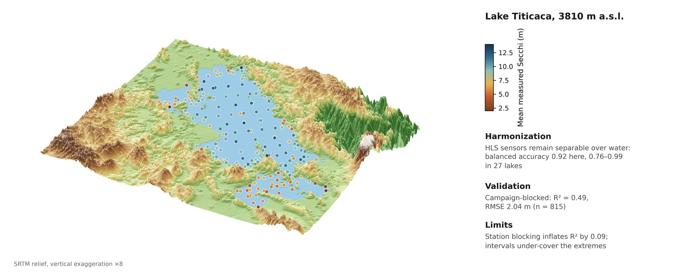
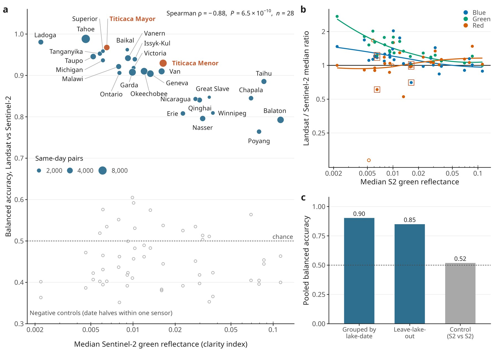
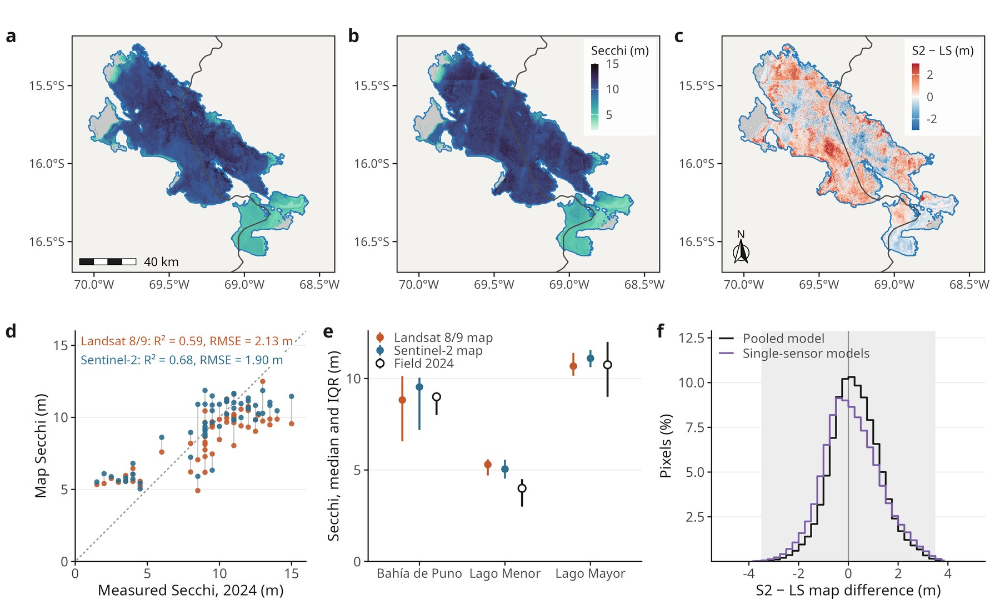
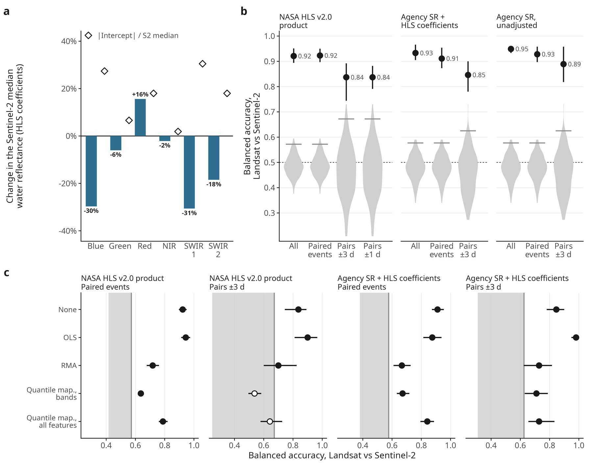
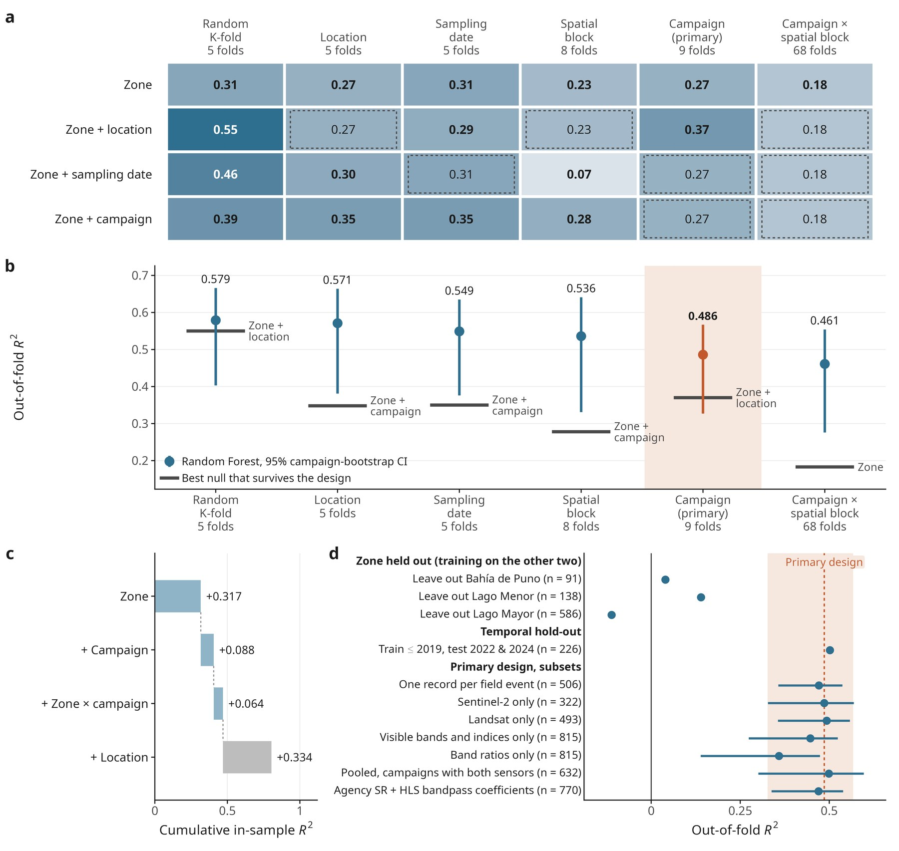
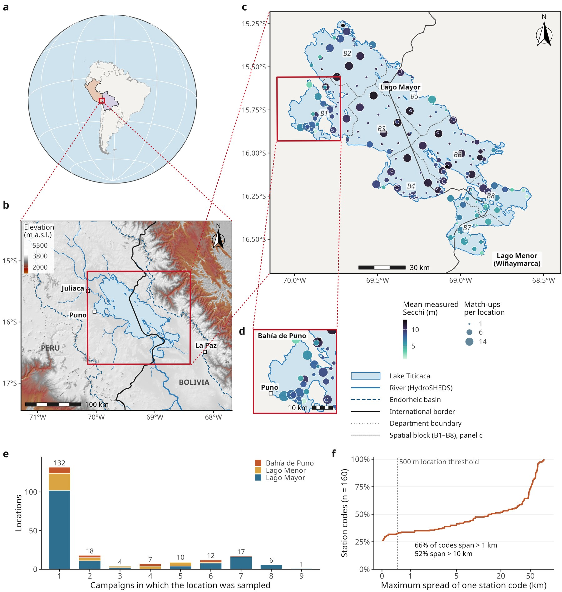

# Harmonized Landsat–Sentinel-2 Separability over Lakes

**Campaign-level validation of satellite Secchi depth in Lake Titicaca**

[](#citation)
[](LICENSE)
[](https://www.python.org/)
[](https://www.r-project.org/)
[](https://doi.org/10.5067/HLS/HLSS30.002)
[](#key-results)

Submitted to *Remote Sensing Applications: Society and Environment* (Elsevier), October 2026. Under review.

<p align="center">
  
</p>

---

## Overview

Merged Landsat 8/9 and Sentinel-2 archives are increasingly used with machine learning to monitor lakes. That practice rests on two assumptions that are rarely tested:

1. **Interchangeability.** The harmonized observations of the two sensors are interchangeable over water.
2. **Validation.** Cross-validation blocked by station gives an unbiased estimate of accuracy.

We tested both with **815 Secchi disk depth match-ups** from nine IMARPE field campaigns in Lake Titicaca (2013–2024), extracted from the **NASA Harmonized Landsat Sentinel-2 (HLS v2.0)** product, and with **93,624 same-day sensor pairs** from **27 large lakes** worldwide.

- A **classifier two-sample test** asks whether a Random Forest can tell which sensor produced a harmonized observation. If the sensors were interchangeable, it could not do better than chance.
- **Hierarchical null models** evaluated under six cross-validation designs identify the unit on which the field record is dependent, without assuming it in advance.

---

## Key results

<table>
<tr><td valign="top" width="50%">

**Sensor separability** (balanced accuracy; chance = 0.5)

| Test | Value |
|------|:-----:|
| Titicaca, HLS product | **0.92** [0.89, 0.95] |
| Titicaca, pairs within ±3 days | 0.84 |
| Negative controls | 0.49 |
| After quantile mapping | 0.54 |
| 27 lakes, same-day pairs | **0.76–0.99** |
| Withheld lake (trained on the others) | 0.85 |
| Top of atmosphere (median) | 0.84 |
| Low sun glint only (> 40°) | 0.93 |

</td><td valign="top" width="50%">

**Secchi retrieval R² by validation design** (Random Forest)

| Folds blocked by | R² |
|------------------|:--:|
| Random | 0.58 |
| Location | 0.57 |
| Sampling date | 0.55 |
| Spatial block | 0.54 |
| **Campaign (primary)** | **0.49** [0.33, 0.57] |
| Campaign × block | 0.46 |

Under campaign blocking: **RMSE 2.04 m**, bias −0.04 m. A multiband linear model reaches the same R² (0.49).

</td></tr>
</table>

- **The HLS product does not make the sensors interchangeable over water.** They were separable in every lake, more so in clearer water (Spearman ρ = −0.88 against green reflectance). The difference is already present at the top of the atmosphere, is enhanced by the atmospheric correction and is not explained by sun glint.
- **The dependence in the field record lies at the level of the campaign.** Blocking by station or by sampling date overestimated R² by 0.09 and 0.06.
- **The offset matters for maps.** Applied to 2024 dry-season composites, the same model gave a Sentinel-2 map deeper than the Landsat map by a median of **+0.24 m** (r = 0.91 between the two maps).
- Conformal 90% intervals reached 89.6% coverage overall (mean width 7.0 m), but under-covered the clearest and most turbid water.

<p align="center">
  
  <br><sub><b>Same-day separability of HLSL30 and HLSS30 over 27 large lakes (2019–2024).</b> (a) Balanced accuracy against median Sentinel-2 green reflectance (lower = clearer water); Titicaca in orange, grey circles are negative controls. (b) Landsat/Sentinel-2 reflectance ratio by band. (c) Tests on the pooled pairs.</sub>
</p>

<p align="center">
  
  <br><sub><b>Secchi depth in the 2024 dry season from HLS composites at 90 m.</b> (a) Landsat 8/9. (b) Sentinel-2. (c) Sentinel-2 minus Landsat. (d) Maps against the 2024 field readings, with models trained without 2024. (e) Medians by zone. (f) Distribution of the map difference.</sub>
</p>

<details>
<summary><b>More figures: separability in Titicaca and validation design</b></summary>
<br>
<p align="center">
  
  <br><sub><b>Separability over Lake Titicaca.</b> (a) Effect of the HLS bandpass coefficients on water reflectance. (b) Balanced accuracy for the HLS product and for agency reflectance, with 95% campaign-bootstrap intervals and 100 negative controls. (c) After per-band recalibration.</sub>
</p>
<p align="center">
  
  <br><sub><b>Validation design.</b> (a) Hierarchical null models under six designs. (b) Random Forest R² by design. (c) Variance decomposition. (d) Zone extrapolation and temporal hold-out.</sub>
</p>
<p align="center">
  
  <br><sub><b>Study area.</b> The 207 match-up locations coloured by mean measured Secchi depth, the Titicaca basin and the reassignment of IMARPE station codes between surveys.</sub>
</p>
</details>

---

## Repository structure

```
harmonized-titicaca-transparency/
├── pipeline/                       # Analysis, run in order (see pipeline/README.md)
│   ├── p00_config.py               # Paths, features, QC, validation designs, bootstrap
│   ├── p01_extract_matchups.py     # Earth Engine extraction (HLS + agency reflectance)
│   ├── p02 … p12                   # Data set, separability, validation, models,
│   │                               #   conformal, SHAP, spatial, trends, windows, 27 lakes
│   ├── p15 … p18                   # Recalibration, 2024 maps, sun glint, TOA test
│   ├── p13_export_numbers.py       # Writes every number quoted in the manuscript
│   ├── p14_verify_manuscript.py    # Checks the text against results/
│   ├── harmonization_check.py      # The sensor two-sample test as a reusable function
│   └── run_all.sh
├── figures/
│   ├── R/                          # One ggplot2 script per figure
│   ├── graphical_abstract/ga_3d.py
│   └── basemap/fetch_basemap.py
├── data/
│   ├── basemap/, lake_boundary/    # Map layers (SRTM, HydroSHEDS, HydroLAKES)
│   └── processed/                  # Satellite reflectance only (no field values)
├── results/
│   ├── metrics/*.json              # Aggregate results behind every reported number
│   ├── models/best_params.json
│   └── figures_r/                  # Paper figures (PNG 600 dpi + PDF)
└── docs/img/                       # Web versions of the figures for this page
```

Figure files map to the submitted manuscript as follows: `fig1`–`fig5` → Figs. 1–5, `fig8_lake_maps` → Fig. 6, `figS1`–`figS4` → Figs. S1–S4, `fig6_spatial_errors` → Fig. S5, `fig7_conformal_uncertainty` → Fig. S6.

---

## Data

| Source | Content | Availability |
|--------|---------|--------------|
| **IMARPE** limnological surveys, 2011–2024 | In-situ Secchi depth and co-measured variables | Collected by the Laboratorio Continental de Puno of IMARPE. Publicly accessible in the [repository](https://github.com/jairo20022/Spatiotemporal-analysis-of-water-quality-in-Lake-Titicaca) that accompanies Mamani-Quispe et al. (2026). **Not redistributed here**; requests for reuse should go to IMARPE |
| **NASA HLS v2.0** (HLSS30, HLSL30) | Harmonized surface reflectance | Open, [NASA LP DAAC](https://doi.org/10.5067/HLS/HLSS30.002) and Google Earth Engine |
| Sentinel-2 L2A, Landsat Collection 2 L2 | Agency surface reflectance (comparison route) | Open, Google Earth Engine |
| `data/processed/hls_matchups_raw.csv` | HLS reflectance at each field measurement (station code and date as key, **no field values**) | This repository |
| `data/processed/multilake_*.csv.gz` | Same-day HLSL30/HLSS30 pairs over 27 lakes: surface reflectance, TOA and view/sun angles | This repository |

No file containing measured field values is versioned. Without the IMARPE record, `p02` cannot rebuild the match-up table, but every aggregate result in `results/metrics/` and every figure is included.

---

## Installation and use

Python **3.14**; figures need **R ≥ 4.4** with ggplot2, sf, terra, patchwork and ggspatial. Extraction (`p01`, `p12`, `p16`–`p18`) needs a Google Earth Engine account.

```bash
python3.14 -m venv .venv
.venv/bin/pip install -r requirements.txt

bash pipeline/run_all.sh --fast      # everything except the slow model selection (p06)
```

To check whether another merged archive is consistent, use the two-sample test on its own:

```python
import pandas as pd
from harmonization_check import harmonization_check   # copy pipeline/harmonization_check.py

df = pd.read_csv("my_matchups.csv")     # one row per observation
res = harmonization_check(df, features=["B2", "B3", "B4", "B8", "B11", "B12"],
                          sensor_col="sensor", group_col="campaign",
                          unit_col="sampling_date")
print(res[["test", "balanced_accuracy", "ba_lo", "ba_hi"]])
# The sensors are interchangeable if the real test falls within the control band.
```

---

## Authors

| Author | Affiliation | ORCID |
|--------|-------------|-------|
| **Dina Maribel Yana-Yucra** | Universidad Nacional del Altiplano | [0009-0003-6218-2735](https://orcid.org/0009-0003-6218-2735) |
| **Vladimiro Ibáñez-Quispe** | Universidad Nacional del Altiplano | [0000-0002-0277-4945](https://orcid.org/0000-0002-0277-4945) |
| **Wilfredo Julián Yzarra-Tito** | SENAMHI, Lima | [0000-0002-7357-5943](https://orcid.org/0000-0002-7357-5943) |
| **Richar Andre Vilca-Solorzano** \* | Universidad Nacional del Altiplano | [0009-0003-2385-5263](https://orcid.org/0009-0003-2385-5263) |
| **Fred Torres-Cruz** | Universidad Nacional del Altiplano | [0000-0003-0834-6834](https://orcid.org/0000-0003-0834-6834) |

<sub>\* Corresponding author: <75521963@est.unap.edu.pe>. Faculty of Statistical and Computer Engineering, UNAP, Puno, Peru.</sub>

---

## Citation

The article is under review. Until it is published, please cite the code:

```bibtex
@software{YanaYucra2026TiticacaHLS,
  author = {Yana-Yucra, Dina Maribel and Iba{\~n}ez-Quispe, Vladimiro and
            Yzarra-Tito, Wilfredo Juli{\'a}n and Vilca-Solorzano, Richar Andre and
            Torres-Cruz, Fred},
  title  = {Harmonized {Landsat}--{Sentinel-2} separability over lakes and
            campaign-level validation of satellite {Secchi} depth in
            {Lake Titicaca}: analysis code},
  year   = {2026},
  url    = {https://github.com/Andre031222/harmonized-titicaca-transparency}
}
```

---

## Acknowledgments

We thank the Laboratorio Continental de Puno of IMARPE for the limnological surveys, and J.N. Mamani-Quispe, J.J. Marquina-Araujo and co-authors for making the station-level record publicly accessible. No external funding was received for this work.

## License

Code under the **MIT License** ([LICENSE](LICENSE)). Satellite data are open (NASA, ESA, USGS). The in-situ data belong to IMARPE and are not covered by this license.
