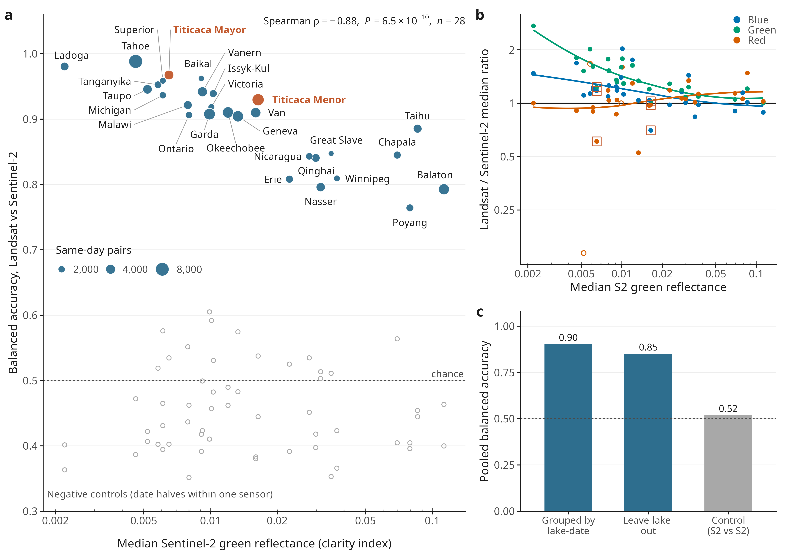

# Landsat–Sentinel-2 separability over lakes and campaign-level validation

Code for a study of Landsat 8/9 – Sentinel-2 interchangeability over lake water
and of validation design for satellite Secchi depth retrieval in Lake Titicaca.

**Manuscript:** *Harmonized Landsat–Sentinel-2 separability over lakes and campaign-level validation of satellite Secchi depth in Lake Titicaca*, prepared for *Remote Sensing Applications: Society and Environment*.
Not yet submitted.

[](LICENSE)
[](https://www.python.org/)
[](https://www.r-project.org/)

## Findings

1. **The NASA HLS v2.0 product does not make Landsat and Sentinel-2
   interchangeable over lake water.**
   - Over Titicaca, a classifier identifies the source sensor of harmonized
     observations with a balanced accuracy of about 0.92, while negative
     controls stay at chance.
   - On about 94,000 same-day pairs from 27 large lakes, the sensors are
     separable in every lake, and more so the clearer the water.
2. **In campaign-based monitoring, the dependence lies at the level of the
   campaign.**
   - Blocking cross-validation by station or by sampling date overstates
     accuracy.
   - Hierarchical null models evaluated under each design identify the right
     blocking unit without assuming it.
3. **Retrieval under leave-one-campaign-out validation:**
   - Secchi depth is retrieved with R² ≈ 0.49 and RMSE ≈ 2.0 m, no better than a
     multiband linear model.
   - The errors have weak short-range spatial structure.
   - Conformal intervals hold marginal coverage but under-cover the extremes.

All figures quoted in the manuscript are generated by `pipeline/p13_export_numbers.py`
from `results/metrics/`; `pipeline/p14_verify_manuscript.py` checks the text against
them.



## Data

| Source | What | Availability |
|---|---|---|
| **IMARPE** limnological surveys, Lake Titicaca, 2011–2024 | In-situ Secchi depth, chlorophyll-*a*, suspended solids, temperature | Property of the Instituto del Mar del Perú; **not redistributed here**. Request from IMARPE. The July 2019 survey is published in Siguayro & Franco (2022) |
| **NASA HLS v2.0** (HLSS30, HLSL30) | Harmonized surface reflectance | Open, via NASA LP DAAC and Google Earth Engine |
| Sentinel-2 L2A, Landsat Collection 2 L2 | Agency surface reflectance (comparison route) | Open, via Google Earth Engine |
| `data/processed/hls_matchups_raw.csv` | HLS reflectance extracted at each field measurement (station code and date as key, no field values) | In this repository |
| `data/processed/multilake_hls_raw.csv.gz` | Same-day HLSL30/HLSS30 pairs over 27 lakes | In this repository |

No file containing measured field values is versioned. Without the IMARPE
record, the pipeline cannot rebuild the match-up table (`p02`). The aggregate
results in `results/metrics/` and the figures are included.

## Pipeline

See [`pipeline/README.md`](pipeline/README.md). In order:

1. Extraction in Earth Engine (`p01`).
2. Data set, locations, campaigns and quality control (`p02`).
3. Sensor two-sample test (`p03`).
4. Validation design (`p04`).
5. Benchmarks and model selection (`p05`, `p06`).
6. Conformal intervals (`p07`).
7. SHAP and retrievability (`p08`).
8. Spatial statistics of the errors (`p09`).
9. Trends (`p10`).
10. Match-up window (`p11`).
11. Multi-lake test (`p12`).
12. Manuscript numbers and verification (`p13`, `p14`).

```bash
python3.14 -m venv .venv && .venv/bin/python -m pip install -r requirements.txt
bash pipeline/run_all.sh --fast      # everything except the slow model selection
```

`pipeline/harmonization_check.py` packages the sensor two-sample test as a
standalone function (numpy, pandas, scikit-learn) for use on other archives.

Figures are built in R (≥ 4.4) with ggplot2 from `figures/R/`.

## Authors

Dina Maribel Yana-Yucra, Vladimiro Ibañez-Quispe, Wilfredo Julián Yzarra-Tito,
Richar Andre Vilca-Solorzano (corresponding, 75521963@est.unap.edu.pe) and
Fred Torres-Cruz. Universidad Nacional del Altiplano, Puno, and SENAMHI, Lima, Peru.

## License

Code: MIT ([LICENSE](LICENSE)). Satellite data are open (NASA, ESA, USGS). The
in-situ data are not covered by this license.
